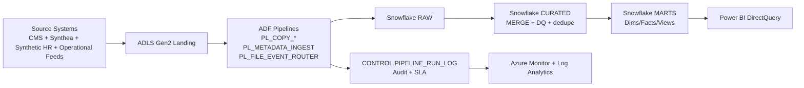

# AMN Healthcare Snowflake + Azure Data Platform Case Study

[](https://azure.microsoft.com/products/data-factory)
[](https://azure.microsoft.com/products/storage/data-lake-storage)
[](https://www.snowflake.com/)
[](https://powerbi.microsoft.com/)
[](https://www.terraform.io/)

This repository now documents an **AMN Healthcare-inspired enterprise data platform case study** centered on **Azure Data Factory + ADLS Gen2 + Snowflake + Power BI DirectQuery + Terraform**.

> **Scope clarity:** The production-style AMN architecture in this README/wiki is case-study documentation. The existing Python telecom implementation in this repository remains intact as the original template/reference codebase and has not been rewritten into a live AMN runtime conversion.

---

## Project Overview

The case study demonstrates how to design a metadata-driven healthcare analytics platform with:

- Event-aware ingestion through Azure Data Factory (ADF)
- Landing/storage on ADLS Gen2
- Layered Snowflake model (`RAW`, `CURATED`, `MARTS`, `CONTROL`)
- DirectQuery analytics in Power BI
- Security/governance and operational observability
- Terraform-managed cloud provisioning

### Verification labels used in this repository

- **Repository-Verified**: Confirmed by repository files available in reviewed AMN source materials.
- **Reference Benchmark**: Published/industry benchmark or target architecture metric, not claimed as achieved in this destination repository.
- **Planned / Conversation-Only**: Discussed design or runtime behavior not fully represented as versioned implementation here.

---

## End-to-End Architecture



---

## Layered Data Flow

1. **Landing & Event Detection (Repository-Verified in source docs):** Files land in ADLS Gen2 `landing/`, optionally routed by event trigger paths.
2. **ADF Orchestration (Repository-Verified in source docs):**
   - Child copy pipelines: `PL_COPY_HOSPITALS`, `PL_COPY_STAFFING_REQUESTS`, `PL_COPY_CANDIDATES`, `PL_COPY_SCHEDULES`, `PL_COPY_PAYROLL`
   - Metadata parent pipeline: `PL_METADATA_INGEST`
   - File routing pipeline: `PL_FILE_EVENT_ROUTER`
   - Triggers: `TR_METADATA_INGEST_BATCH_READY`, `TR_LANDING_CSV_CREATED`
3. **RAW Layer (Repository-Verified in source docs):** Source-shaped append-first data with ingest metadata columns.
4. **CURATED Layer (Repository-Verified in source docs):** Typed, deduplicated, idempotent merge logic and data quality standardization.
5. **MARTS Layer (Repository-Verified in source docs):** Analytics-ready dimensions, facts, and executive reporting views.
6. **BI Consumption (Repository-Verified in source docs):** Power BI DirectQuery reads Snowflake marts.

---

## Snowflake Schema & Table Reference

| Layer | Snowflake Schema | Purpose |
|---|---|---|
| Landing Raw | `AMN_DEV.RAW` | Source-shaped raw ingestion with audit metadata |
| Curated | `AMN_DEV.CURATED` | Cleansed, typed, deduplicated business entities |
| Analytics | `AMN_DEV.MARTS` | Star-schema dimensions/facts and BI serving views |
| Control Plane | `AMN_DEV.CONTROL` | Ingestion config, run logs, SLA/observability metadata |

### Core marts model entities (Repository-Verified in source docs)

- Dimensions: `DIM_HOSPITAL`, `DIM_CANDIDATE`, `DIM_DATE` (and associated domain dimensions)
- Facts: `FACT_STAFFING_REQUEST`, `FACT_PLACEMENT_SCHEDULE`, `FACT_PAYROLL`
- Views: `VW_EXECUTIVE_KPIS`, `VW_RECRUITING_FUNNEL`, `VW_PIPELINE_RUNS`, `VW_PIPELINE_LATEST_STATUS`

---

## Analytics Features

- Executive workforce KPIs (demand, fill-rate, staffing performance)
- Recruiting funnel analytics
- Payroll/overtime analytics
- Pipeline observability dashboards driven by control-plane logs
- DirectQuery model strategy for near-real-time decision support

> Metrics such as **99.9% success**, **1–3 minute SLA**, **>100 GB/day**, **1,176 tables**, or **93% cost reduction** are treated in this repository as **Reference Benchmarks** unless independently validated in this destination codebase.

---

## Repository Structure (Destination Repository)

```directory
telecom-project/
├── README.md                        # This AMN case-study overview
├── wiki/
│   └── Case-Study-Blog.md           # Detailed AMN case-study write-up
├── architecture/                    # Existing reference architecture images
├── src/                             # Original telecom Python pipeline/template implementation
├── data/                            # Original telecom sample data
├── dashboard_output/                # Original telecom dashboard assets
├── dashboard_spec.json
└── dbt_lineage.html
```

---

## Technology Stack (Case-Study Architecture)

| Layer | Technology | Role |
|---|---|---|
| Ingestion Orchestration | Azure Data Factory | Metadata-driven copy/orchestration pipelines |
| Data Lake | ADLS Gen2 | Landing, checkpoint, archive/quarantine zones |
| Warehouse | Snowflake | `RAW`/`CURATED`/`MARTS`/`CONTROL` schemas |
| BI | Power BI (DirectQuery) | Executive dashboards with live warehouse query pattern |
| IaC | Terraform | Declarative provisioning for Azure resources, RBAC, diagnostics |
| Observability | Azure Monitor + Log Analytics | Pipeline diagnostics, KQL alerts, SLA tracking |
| Secrets | Azure Key Vault | Credential and secret isolation |

---

## Quickstart (Documentation-First)

1. Review this README for architecture and repository context.
2. Open the full case study at [`wiki/Case-Study-Blog.md`](wiki/Case-Study-Blog.md).
3. Use this repository as:
   - A **documentation template** for AMN-style Azure+Snowflake platform design, and
   - An **implementation reference** for the existing telecom Python assets already present in `src/`.

---

## Current Limitations & Disclaimer

- This destination repository is not claiming a complete production AMN runtime migration.
- The AMN content here is architecture/case-study documentation derived from reviewed source materials.
- Any benchmark-scale outcomes from public AMN narratives are retained as **reference targets**, not asserted achieved results in this repository.
- No infrastructure credentials, secrets, or private data are stored in this documentation.

---

## Maintainer

**Arham Sheikh** — Data Engineer  
GitHub: [@arhamsheikh17](https://github.com/arhamsheikh17)
