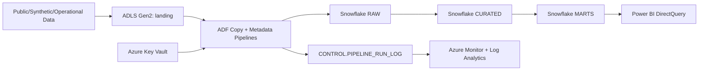

# AMN Healthcare Snowflake + Azure Case Study (Rewritten)

## Table of Contents
1. [Executive Overview](#1-executive-overview)
2. [Business Context](#2-business-context)
3. [Problem Statement](#3-problem-statement)
4. [Legacy Challenges](#4-legacy-challenges)
5. [Modernization Approach](#5-modernization-approach)
6. [Target Architecture](#6-target-architecture)
7. [End-to-End Data Flow](#7-end-to-end-data-flow)
8. [Data Preparation](#8-data-preparation)
9. [ADLS Gen2 Lake Layer](#9-adls-gen2-lake-layer)
10. [ADF Orchestration Layer](#10-adf-orchestration-layer)
11. [Snowflake RAW/CURATED/MARTS/CONTROL Layers](#11-snowflake-rawcuratedmartscontrol-layers)
12. [Transformation and Data Quality Logic](#12-transformation-and-data-quality-logic)
13. [Dimensional Model and Marts](#13-dimensional-model-and-marts)
14. [Power BI Executive Analytics](#14-power-bi-executive-analytics)
15. [Observability and SLA Monitoring](#15-observability-and-sla-monitoring)
16. [Terraform and Infrastructure as Code](#16-terraform-and-infrastructure-as-code)
17. [Security and Governance](#17-security-and-governance)
18. [Repository Structure Mapping](#18-repository-structure-mapping)
19. [Testing and Acceptance Criteria](#19-testing-and-acceptance-criteria)
20. [Current Status and Limitations](#20-current-status-and-limitations)
21. [Future Improvements](#21-future-improvements)
22. [Key Takeaways](#22-key-takeaways)
23. [Disclaimer](#23-disclaimer)

---

## 1. Executive Overview

This case study documents a modernization pattern for healthcare staffing analytics using **Azure Data Factory**, **ADLS Gen2**, **Snowflake**, **Power BI DirectQuery**, and **Terraform**. The design goal is a governed, metadata-driven platform with workload isolation, auditable transformations, and near-real-time analytics consumption.

### Status Legend

- **Repository-Verified (Source-Verified):** Confirmed in the reviewed AMN source documents (`README.md`, `PROJECT_CONTEXT.md`, `infra/adf/README.md`, source wiki).
- **Reference Benchmark:** Public/published benchmark or target metric; not asserted as achieved in this destination repository runtime.
- **Planned / Unverified Here:** Architectural intent or future implementation not fully represented in this destination repository’s executable assets.

---

## 2. Business Context

Healthcare staffing operations coordinate high-urgency demand (hospital staffing requests) with constrained talent supply (licensed clinicians), while balancing credentialing, scheduling, payroll, and compliance. Business stakeholders need consistent, low-latency operational visibility across recruiting funnel, placements, and labor-cost performance.

---

## 3. Problem Statement

Legacy analytics stacks commonly introduce:

- Stale overnight batch reporting windows
- Operational DB contention from analytics workloads
- Inconsistent KPI definitions across disconnected ETL jobs
- High cloud/compute cost due to poor workload isolation

The modernization objective is to decouple ingestion from analytics while enforcing data quality, replayability, and observability.

---

## 4. Legacy Challenges

| Challenge | Business Impact | Modernization Requirement |
|---|---|---|
| Batch-only ingestion | Delayed staffing decisions | Event/micro-batch ingestion pattern |
| Shared compute contention | Unstable operational performance | Dedicated compute by workload |
| Fragmented transformation logic | KPI trust issues | Centralized curated + marts model |
| Weak run diagnostics | Slow incident response | Control-plane logs + SLA monitoring |

---

## 5. Modernization Approach

1. **Metadata-driven orchestration:** Drive ingestion behavior from control metadata instead of hardcoded pipeline sprawl.
2. **Layered Snowflake schemas:** Keep raw immutable landing separate from curated business entities and marts.
3. **Idempotent merge strategy:** Use deterministic dedupe/upsert logic for safe retries and backfills.
4. **Workload isolation:** Separate ingestion, transform, and BI warehouses.
5. **Infrastructure as code:** Provision cloud resources and identity controls with Terraform.

---

## 6. Target Architecture



---

## 7. End-to-End Data Flow

1. Files/events land in ADLS Gen2 (`landing/`) with checkpoint/quarantine/archive conventions. **(Repository-Verified in source docs)**
2. ADF pipelines orchestrate loading into Snowflake raw tables. **(Repository-Verified in source docs)**
3. Curated merges apply type casting, normalization, deduplication, and business rules. **(Repository-Verified in source docs)**
4. Marts build dimensional facts/views consumed by BI. **(Repository-Verified in source docs)**
5. Control-plane run logs capture timings, row counts, statuses, and SLA outcomes. **(Repository-Verified in source docs)**

---

## 8. Data Preparation

Case-study preparation combines:

- **CMS public hospital reference data**
- **Synthetic Synthea clinical datasets**
- **Synthetic HR/workforce datasets**
- **Operational-like incremental feeds for staffing workflows**

These datasets are documentation-safe and suitable for architecture validation without exposing private patient data.

---

## 9. ADLS Gen2 Lake Layer

Documented storage zones include:

- `landing/` for inbound files
- `checkpoint/` for process markers/batch readiness
- `quarantine/` for schema-invalid or failed files
- `archive/` for historical retention

This separation supports replayability, compliance, and incident isolation.

---

## 10. ADF Orchestration Layer

Documented pipeline inventory includes:

- `PL_COPY_HOSPITALS`
- `PL_COPY_STAFFING_REQUESTS`
- `PL_COPY_CANDIDATES`
- `PL_COPY_SCHEDULES`
- `PL_COPY_PAYROLL`
- `PL_METADATA_INGEST`
- `PL_FILE_EVENT_ROUTER`

Documented triggers include:

- `TR_METADATA_INGEST_BATCH_READY`
- `TR_LANDING_CSV_CREATED`

`PL_METADATA_INGEST` is metadata-driven and routes configured source objects into appropriate child copy flows. **(Repository-Verified in source docs)**

---

## 11. Snowflake RAW/CURATED/MARTS/CONTROL Layers

| Schema | Role |
|---|---|
| `AMN_DEV.RAW` | Source-native landing with ingest metadata |
| `AMN_DEV.CURATED` | Cleaned, typed, deduplicated business entities |
| `AMN_DEV.MARTS` | Dimensional models and BI-facing views |
| `AMN_DEV.CONTROL` | Ingestion config, run logs, and observability metadata |

Warehouse isolation pattern (ingest/transform/BI) is explicitly described in source documentation.

---

## 12. Transformation and Data Quality Logic

Documented transformation techniques include:

- `ROW_NUMBER`-based deterministic dedupe
- `MERGE`-based idempotent upserts
- `NULLIF(TRIM())` normalization
- Safe cast patterns (`TRY_TO_*`)
- Controlled boolean normalization
- Change-only updates (`IS DISTINCT FROM`) where applicable

These are applied in curated logic to preserve correctness under retries and incremental updates.

---

## 13. Dimensional Model and Marts

Common marts entities documented in source materials:

- Dimensions: `DIM_HOSPITAL`, `DIM_CANDIDATE`, `DIM_DATE`
- Facts: `FACT_STAFFING_REQUEST`, `FACT_PLACEMENT_SCHEDULE`, `FACT_PAYROLL`
- Views: `VW_EXECUTIVE_KPIS`, `VW_RECRUITING_FUNNEL`, `VW_PIPELINE_RUNS`, `VW_PIPELINE_LATEST_STATUS`

The model supports executive staffing, recruiting, payroll, and operational health reporting.

---

## 14. Power BI Executive Analytics

Power BI connects via DirectQuery to Snowflake marts for:

- Executive KPI monitoring
- Recruiting funnel analysis
- Clinical staffing operations
- Payroll and overtime visibility
- Pipeline SLA/latency visibility

> Claims such as sub-second responses should be treated as **Reference Benchmarks** unless validated in this destination repository runtime.

---

## 15. Observability and SLA Monitoring

Observed/documented observability patterns:

- Control tables for run metadata (`CONTROL.PIPELINE_RUN_LOG`)
- SLA-evaluation views (`VW_PIPELINE_RUNS`)
- Latest status extraction (`VW_PIPELINE_LATEST_STATUS`)
- Azure Monitor / Log Analytics diagnostics and alerting

Operationally, this enables incident triage, replay planning, and SLA trend tracking.

---

## 16. Terraform and Infrastructure as Code

Terraform is used to provision and govern:

- ADF assets and linked services
- Storage and identity wiring
- Diagnostics/logging settings
- Role assignments and environment consistency

The source documentation emphasizes sanitized definitions and secret-free infrastructure definitions.

---

## 17. Security and Governance

Security controls documented in source materials include:

- Azure Key Vault for secrets (no hardcoded credentials)
- Managed identity access patterns
- Role-based Snowflake access separation
- PII governance for analytics exposure

This approach aligns with least-privilege and auditable access requirements.

---

## 18. Repository Structure Mapping

### Destination repository (`arhamsheikh17/telecom-project`)

```text
README.md                       -> AMN case-study overview (this rewrite)
wiki/Case-Study-Blog.md         -> detailed case-study narrative (this file)
src/, data/, dashboard_output/  -> existing telecom reference implementation (unchanged)
```

### Important clarity

This repository now presents AMN case-study architecture documentation while preserving the telecom code implementation as historical/template assets. Documentation should not be interpreted as a claim that telecom runtime code has been converted to Snowflake/Azure.

---

## 19. Testing and Acceptance Criteria

For architecture implementation programs using this pattern, suggested acceptance checks:

- Idempotent replay (no duplicate business keys)
- CDC/incremental correctness under inserts/updates/deletes
- Curated-vs-source reconciliation consistency
- SLA tracking visibility with alerting
- Least-privilege and secret-isolation controls

**Reference target examples (not claimed achieved here):**

- 99.9% pipeline success
- 1–3 minute freshness for critical Tier-1 entities
- High-scale table onboarding via metadata-driven ingestion

---

## 20. Current Status and Limitations

- **Repository-Verified in destination:** documentation rewrite, structural case-study mapping, and explicit benchmark disclaimers.
- **Not claimed in destination runtime:** full AMN-scale live ingestion metrics, production SLAs, validated >100 GB/day throughput, 1,176-table operational replication, or 93% cost savings.
- **Code scope:** no source/infrastructure runtime refactor performed in this task.

---

## 21. Future Improvements

1. Add companion architecture diagrams under versioned `wiki/` assets if approved.
2. Add executable examples for metadata-control table DDL and generic ADF parameter contracts.
3. Publish reproducible benchmark test harness and evidence logs before promoting reference targets to achieved metrics.
4. Expand operational runbook templates (replay, backfill, SLA breach triage).

---

## 22. Key Takeaways

- Separate ingestion, transform, and BI compute to reduce contention.
- Keep raw immutable; enforce business correctness in curated and marts layers.
- Use metadata-driven pipelines to scale onboarding cleanly.
- Treat benchmark claims as targets until independently validated.
- Preserve implementation/documentation boundary to avoid misleading architecture claims.

---

## 23. Disclaimer

This documentation is a rewritten educational/engineering case study aligned to AMN-inspired source materials and repository-safe architecture descriptions. It uses synthetic/public dataset framing and does not expose secrets, patient-sensitive data, or private production credentials. Published AMN-related benchmark figures are retained only as reference benchmarks unless independently verified in this destination repository.
